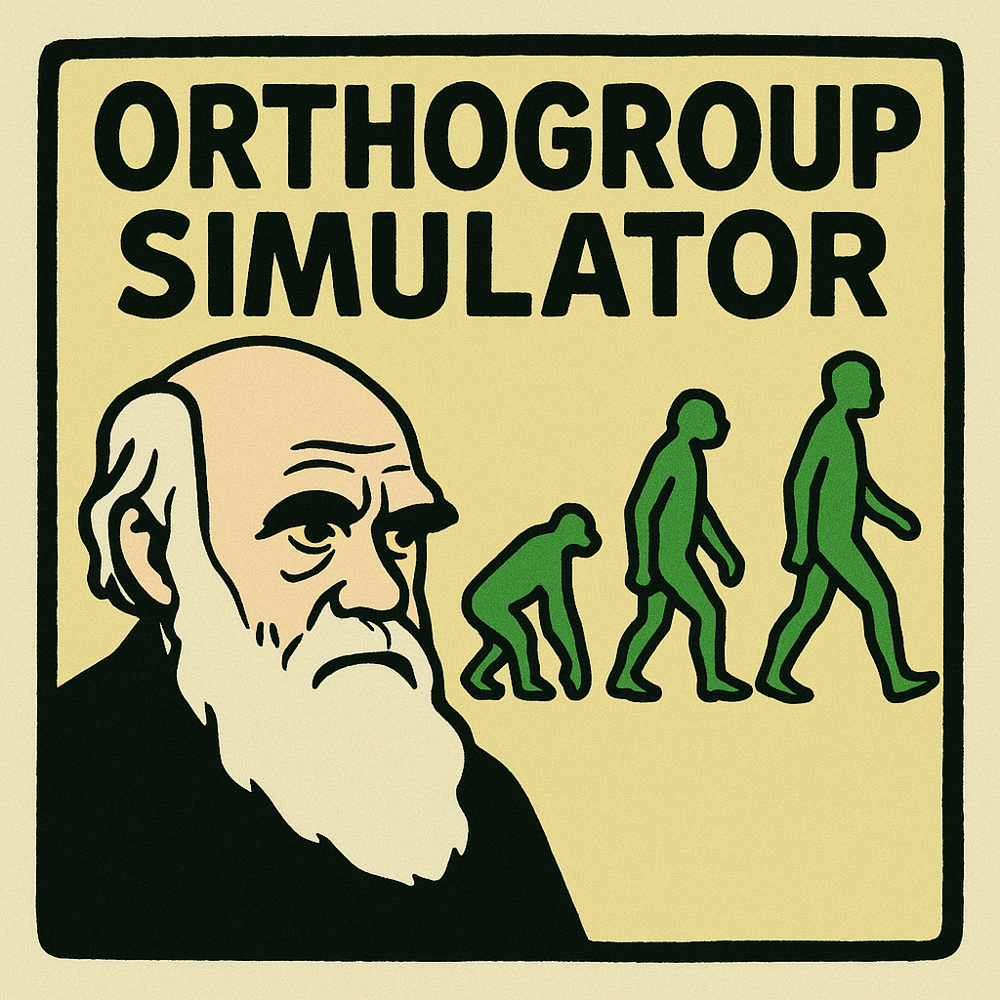

# OrthoSimulator

OrthoSimulator simulates orthogroups that resemble the orthogroups of real species, and records the true orthogroups and true orthologs of every simulated gene. You can use the simulated data to test how well an orthology inference tool recovers the truth.

The simulations are trained on real data. You give OrthoSimulator the orthogroups that an inference tool found in your own proteomes, and it estimates the parameters that make simulated orthogroups look like them: gene tree shape, duplication and loss, sequence evolution, indels and gaps, and protein domain structure.

<p align="left">
  
</p>

## Contents

- [Installation](#installation)
- [Quick start](#quick-start)
- [The four workflows](#the-four-workflows)
- [Simulating orthogroups](#simulating-orthogroups)
- [Incomplete lineage sorting (optional)](#incomplete-lineage-sorting-optional)
- [Estimating parameters from your own data](#estimating-parameters-from-your-own-data)
- [Tuning duplication and loss rates](#tuning-duplication-and-loss-rates)
- [PFAM data](#pfam-data)
- [Output files](#output-files)
- [Benchmarking an orthology inference tool](#benchmarking-an-orthology-inference-tool)
- [Citation](#citation)
- [Licence](#licence)
- [Contact](#contact)

## Installation

Clone the repository and create the conda environment:

```bash
git clone https://github.com/lauriebelch/OrthoSimulator.git
cd OrthoSimulator
conda env create -f environment.yml
conda activate orthosimulator
```

The environment installs Python, MAFFT, trimAl, Java and the Python packages that OrthoSimulator needs. IQ-TREE 3 and SaGePhy are included in `bin/`. If the files in `bin/` are not executable on your system, run `chmod +x bin/*`.

## Quick start

This simulates 100 orthogroups from the example data (it takes about a minute):

```bash
python OrthoSimulator.py \
  --Orthogroup-simulation \
  --output ExampleSimulation \
  --Config ExampleData/example_simulation_config.txt \
  --threads 4
```

The results are written to `ExampleSimulation/`. See [Output files](#output-files).

## The four workflows

Each run uses one workflow flag.

| Flag | What it does |
|---|---|
| `--Get-Parameters` | Estimates simulation parameters from the orthogroups that an inference tool found in real proteomes. |
| `--GA` | Tunes the duplication rate, loss rate and orthogroup birth bias with a genetic algorithm, so that simulated orthogroups match the real ones. |
| `--Orthogroup-simulation` | Simulates orthogroups from a set of parameters. |
| `--PFAM` | Finds protein domains in a proteome so that it can be used as a source of starting sequences. Only needed for species that are not already supplied (see [PFAM data](#pfam-data)). |

A full run goes `--Get-Parameters`, then `--GA`, then `--Orthogroup-simulation`.

Every workflow takes `--output` (a folder that must not exist yet) and `--threads` (default 1). Parameters can be given in a config file with `--Config`, as flags on the command line, or both. When a parameter is given in both places, the command-line value is used.

## Simulating orthogroups

```bash
python OrthoSimulator.py \
  --Orthogroup-simulation \
  --output MySimulation \
  --Config ExampleData/example_simulation_config.txt \
  --Orthogroups 1000 \
  --threads 8
```

Each simulated orthogroup starts from a real protein of the starting species. A gene tree is simulated on your species tree with SaGePhy, including duplications and losses, and branch lengths are varied between branches. IQ-TREE AliSim then evolves the sequence along the tree. Domain regions (from PFAM) and non-domain regions are simulated with different models, and gaps are placed to match the gap patterns of real alignments.

A config file has one `key=value` per line. `ExampleData/example_simulation_config.txt` shows all the keys. Every key can also be given as a command-line flag, with underscores written as hyphens (`max_duplication_rate` becomes `--max-duplication-rate`).

| Key | Meaning |
|---|---|
| `ultrametric_tree` | Ultrametric species tree in Newick format. |
| `species` | Species whose proteins are used as starting sequences. It needs PFAM data (see [PFAM data](#pfam-data)). |
| `Orthogroups` | Number of orthogroups to simulate. |
| `prop_invar_mean`, `prop_invar_sd` | Mean and standard deviation of the distribution of the proportion of invariant sites. |
| `gamma_shape_mean`, `gamma_shape_sd` | Mean and standard deviation of the distribution of the gamma shape (rate variation among sites). |
| `max_indel_insert`, `max_indel_delete` | Maximum insertion and deletion rates. |
| `indel_size` | Indel-size parameter used during sequence simulation. |
| `max_duplication_rate`, `max_loss_rate` | Maximum duplication and loss rates for the gene trees. |
| `max_transfer_rate`, `replacement_prob` | Maximum horizontal transfer rate, and the probability that a transfer replaces an existing gene. |
| `leaf_sampling_probability` | Probability that a gene at the tips of the tree is kept. |
| `relax_model`, `max_start_rate` | Model for rate variation among branches (for example `ACRY07`) and its starting rate. |
| `sigma_log_mean`, `sigma_log_sd` | Mean and standard deviation (in log space) of the branch-rate variation parameter. |
| `gbc` | Orthogroup birth bias, which controls where on the species tree orthogroups tend to arise. |
| `gap_file` | Table of gap positions from real alignments, used to place gaps. |
| `ils_theta` | Optional. Switches on incomplete lineage sorting. See the next section. |

## Incomplete lineage sorting (optional)

SaGePhy joins gene lineages exactly at each speciation, so by itself it cannot produce incomplete lineage sorting (ILS). To test the effect of ILS, add `--ils-theta` (or `ils_theta=` in the config file). After SaGePhy simulates a gene tree, OrthoSimulator rearranges the tree under the multispecies coalescent and uses the rearranged tree to simulate the sequences. Lower values of theta give more ILS. Theta must be greater than 0. Very small values make the gene trees extremely deep: 0.1 works, but 0.01 is impractically slow.

```bash
python OrthoSimulator.py \
  --Orthogroup-simulation \
  --output MySimulationILS \
  --Config ExampleData/example_simulation_config.txt \
  --ils-theta 10
```

ILS is off unless you set theta, and the rearrangement step is skipped completely when it is off. The true orthologs are always read from the original SaGePhy tree, so ILS does not change the ground truth. `--GA` does not tune theta: set it yourself.

With ILS on, `Simulated_Orthogroup_statistics.txt` records `ils_theta` and `ils_norm_rf` for each orthogroup. `ils_norm_rf` is the normalised Robinson-Foulds distance between the original and rearranged tree (0 is no change, 1 is completely different), and is `NA` for trees that are too small to compare.

## Estimating parameters from your own data

`--Get-Parameters` reads the orthogroups that an inference tool found in real proteomes and writes the parameters needed for simulation.

```bash
python OrthoSimulator.py \
  --Get-Parameters \
  --output Training_OF3 \
  --tool OF3 \
  --tool-output path/to/OrthoFinder/Results \
  --threads 8
```

| Option | Meaning |
|---|---|
| `--tool` | `OF3` (OrthoFinder 3), `FASTOMA`, `BROCCOLI`, `SONICPARANOID2` or `ORTHOXML`. |
| `--tool-output` | Output folder of the inference run. For `ORTHOXML` this is the `.orthoxml` file itself. |
| `--tools-proteomes` | Folder of the input proteomes. Required for every tool except `OF3`. |
| `--tool-tree` | Species tree. Required for `BROCCOLI`, `SONICPARANOID2` and `ORTHOXML`. Optional for `FASTOMA`. |

Up to 5000 orthogroups with 4 to 499 genes are sampled at random to estimate the parameters, so two runs on the same input give slightly different estimates. Each sampled orthogroup is aligned with MAFFT, trimmed with trimAl, and a tree is built with IQ-TREE.

## Tuning duplication and loss rates

Duplication rate, loss rate and orthogroup birth bias cannot be read directly from the orthogroups, so `--GA` searches for values that make the simulated orthogroups match the real ones in their number of genes, number of species and number of duplications. It uses the multi-objective NSGA-II algorithm (pygad) and takes the output folder of `--Get-Parameters`.

```bash
python OrthoSimulator.py \
  --GA \
  --output GA_OF3 \
  --Config ExampleData/GA_CONFIG.txt \
  --threads 8
```

`ExampleData/GA_CONFIG.txt` lists the options. Set `Orthogroup_train_results` in it to your `--Get-Parameters` output folder.

## PFAM data

OrthoSimulator uses PFAM domain annotations to simulate domain and non-domain regions differently. Precomputed data is included for twelve species: *Homo sapiens*, *Mus musculus*, *Gallus gallus*, *Danio rerio*, *Drosophila melanogaster*, *Mnemiopsis leidyi*, *Arabidopsis thaliana*, *Triticum aestivum*, *Chlamydomonas reinhardtii*, *Saccharomyces cerevisiae*, *Escherichia coli* and *Haloferax volcanii*.

The data for each species is stored as one compressed file, `PFAM/archives/<species>.tar.xz`. OrthoSimulator unpacks the species it needs the first time you use it, so you do not need to do anything. To unpack everything in advance, run `python scripts/PFAM/pfam_archive.py unpack`.

To use another species as the source of starting sequences, run `--PFAM` on its proteome. This needs `pfam_scan.pl`, HMMER and `wget` on your path. They are easiest to install in an environment of their own, because they need a newer Perl than fits in the `orthosimulator` environment:

```bash
conda create -n pfamtools -c conda-forge -c bioconda pfam_scan hmmer wget "perl>=5.32"
```

Then, with the `orthosimulator` environment active, put just those programs first on your path before running `--PFAM`:

```bash
mkdir -p pfam_tools_bin
for t in pfam_scan.pl hmmscan hmmpress perl wget; do ln -sf "$(conda run -n pfamtools which $t)" pfam_tools_bin/$t; done
export PATH="$PWD/pfam_tools_bin:$PATH"
```

The first `--PFAM` run downloads the Pfam-A database into `PFAM/pfam_db/` and prepares it for HMMER (`scripts/PFAM/download_pfamDB.sh`); later runs reuse it. For each domain found, `--PFAM` downloads the domain's seed alignment from InterPro and estimates a substitution model with IQ-TREE, so it needs an internet connection. Most domains take seconds, but a domain with a very large seed alignment (thousands of sequences) can take an hour or more.

```bash
python OrthoSimulator.py \
  --PFAM \
  --output PFAM_MySpecies \
  --Proteome path/to/MySpecies.fa \
  --threads 8
```

The results are stored in `PFAM/` under the name of the FASTA file without its extension (here `MySpecies`). To simulate from the new species, set `species=MySpecies` in the simulation config, or pass `--species MySpecies`.

## Output files

A simulation writes these files to `--output`.

| File or folder | Contents |
|---|---|
| `Simulated_Orthogroups.txt` | The true orthogroups: one row per orthogroup and one column per species, listing that species' genes. |
| `Simulated_orthologs.txt` | The true ortholog pairs, with their orthogroup and species. |
| `Simulated_Orthogroup_statistics.txt` | One row per orthogroup: number of genes, species, duplications and losses, the model parameters used, and (with ILS on) the ILS columns. |
| `alignment_files/` | The simulated alignment of each orthogroup. |
| `tree_files/` | The gene tree of each orthogroup. |
| `proteome_files/` | The simulated proteomes, one FASTA file per species. These are the input for an orthology inference tool. |
| `temporary_files/` | Intermediate files for each orthogroup, including the original SaGePhy trees. |
| `config.txt`, `orthogroup_simulation_parameters.txt`, `Run_log.txt` | The settings used and a log of the run. |

Simulated genes are named `<species>_<orthogroup>_<copy>`.

Occasionally AliSim cannot simulate an orthogroup, for example when a very deep tree and a high deletion rate delete nearly every site. That orthogroup is then skipped and left out of every output file, and the run ends with a warning that lists the skipped orthogroups.

## Benchmarking an orthology inference tool

1. Run your inference tool on the files in `proteome_files/`.
2. Score its orthogroups against the truth with `benchmarking/benchmark.py`:

```bash
python benchmarking/benchmark.py \
  --output-folder MySimulation \
  --tool-output path/to/tool/output \
  --tool orthofinder \
  --csv scores.csv
```

`--tool` can be `orthofinder`, `fastoma`, `broccoli` or `sonicparanoid2`. The script reports missing reference orthogroups, missing genes, fusion, fission, recall, precision, F1 and entropy.

The other scripts in `benchmarking/` are `bootstrap_rank_support.py` and `bootstrap_rank_summarize.py`, which test how well supported the OrthoBench ranking of tools is, and `check_paper_numbers.py`, which recomputes the headline numbers in the paper from the result tables.

## Citation

Holmes J, Kelly SK, Belcher LJ. OrthoSimulator: Empirically trained simulations for ground-truth benchmarking of orthology inference. *bioRxiv* (2026).

## Licence

OrthoSimulator is released under the GNU General Public License v3.0 (see `LICENSE`). IQ-TREE and SaGePhy in `bin/` are distributed under their own licences.

## Contact

Please report problems as [GitHub issues](https://github.com/lauriebelch/OrthoSimulator/issues).
